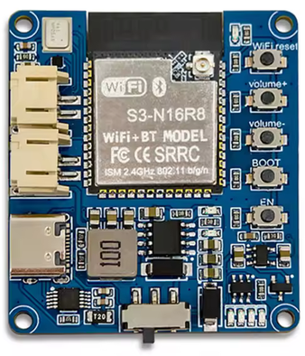
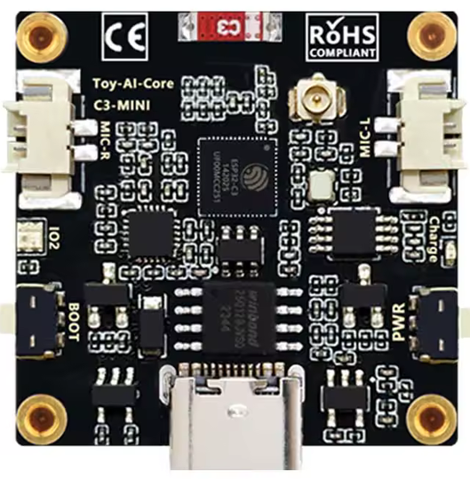
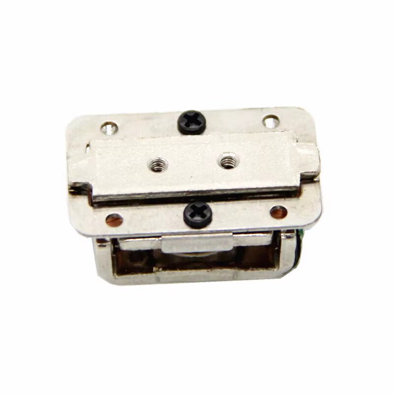
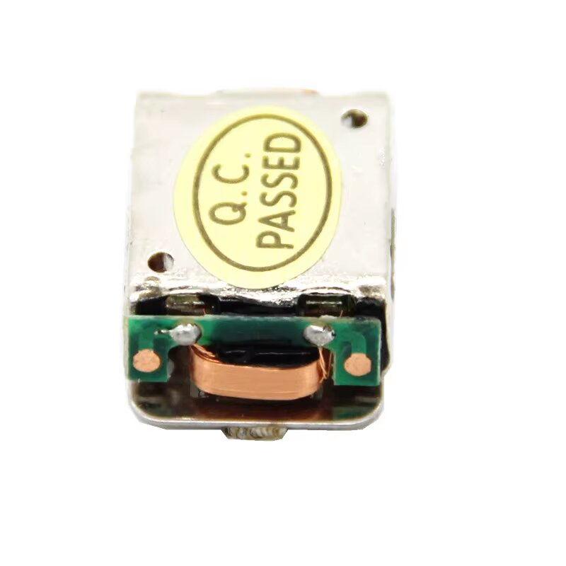

# Canfunk

[Deutsch](README.md) | **English**

Canfunk is an encrypted walkie-talkie built from tin cans. Two (or more) cans talk to each other directly over ESP-NOW, no router needed. A smartphone hotspot is only used at boot for firmware updates (OTA).

The firmware runs on two hardware variants that work with each other:

| | **Variant A: ESP32-S3 can** | **Variant B: Toy-AI-Core-C3-MINI** |
|---|---|---|
| PlatformIO environment | `retro-phone` (default) | `toy-c3` |
| Board | ESP32-S3 voice chat board "Xiaozhi AI" | SpotPear Toy-AI-Core-C3-MINI |
| Microphone / amplifier / battery charging | on the board | on the board |
| External antenna | usually only after swapping the module (see build guide) | IPEX connector on board |
| ADXL345 tilt sensor (TILT, ringing) | fitted separately, default | optional, off by default |
| Buttons | BOOT, PTT, VOL+, VOL- (on the board) | BOOT only (multi-click) |
| Status | tested in use | builds, not yet tested on the board |

---

## Contents

1. [Features](#features)
2. [Building and flashing](#building-and-flashing)
3. [Why these boards?](#why-these-boards)
4. [Build guide variant A: ESP32-S3 can](#build-guide-variant-a-esp32-s3-can)
5. [Build guide variant B: Toy-AI-Core-C3-MINI](#build-guide-variant-b-toy-ai-core-c3-mini)
6. [Configuration (platformio.ini)](#configuration-platformioini)
7. [First setup: calibration and pairing](#first-setup-calibration-and-pairing)
8. [Operation](#operation)
9. [OTA update via hotspot](#ota-update-via-hotspot)
10. [Serial console](#serial-console)
11. [Technical details and troubleshooting](#technical-details-and-troubleshooting)

---

## Features

- **Voice radio** over ESP-NOW, G.711 u-law, 16 kHz, mono. AES-128 encrypted after pairing (basic protection against casual eavesdropping, not secure encryption, see [Security](#security)).
- **Three ways to transmit:**
  - **Button (PTT)**: always transmits while held.
  - **TILT**: tilting the can towards your mouth (35–70 degrees) starts transmitting; holding it to your ear or standing it upright stops.
  - **VOX**: voice activation, transmits as soon as you speak (1 s hang time).
- **Ringing**: cranking one can (swinging it in circles for about 1 s) rings every other can that is standing **upside down**.
- **OTA update** through a web page via a smartphone hotspot.
- All settings (volume, mode, sensitivity, calibration, key) are stored in flash (NVS).

---

## Building and flashing

You need [PlatformIO](https://platformio.org/) (CLI or VS Code extension). PlatformIO downloads the framework (ESP-IDF 5.2.1) on the first build.

```bash
git clone https://github.com/Snake4you/raviolitalk.git
```

```bash
cd raviolitalk
```

```bash
cp platformio_local.ini.example platformio_local.ini
```

Enter your own credentials for the OTA hotspot in `platformio_local.ini` (see [Your own credentials](#your-own-credentials-platformio_localini)). Then build and flash:

```bash
pio run -e retro-phone
```

```bash
pio run -e retro-phone -t upload
```

```bash
pio device monitor -b 115200
```

For variant B use `-e toy-c3` instead of `-e retro-phone` everywhere. The firmware files for OTA end up in `.pio/build/<environment>/firmware.bin`.

Several devices connected? Find the port with `pio device list` and pass it with `--upload-port` or `-p` (e.g. `/dev/ttyUSB0` on Linux, `COM8` on Windows).

The unit tests for the tilt, crank and volume logic are standalone programs and run with any C++ compiler on your PC (no error = passed):

```bash
for t in test/test_*.cpp; do g++ -std=c++17 -Iinclude "$t" -o /tmp/canfunk_test && /tmp/canfunk_test && echo "OK $t"; done
```

---

## Why these boards?

Both variants use ready-made "AI voice" development boards. They already carry almost everything a radio can needs:

- ESP32 (S3 or C3)
- microphone
- speaker amplifier
- battery charger
- connector for an external antenna (important, because the can is made of metal)

Only the vibration speaker, battery, antenna and the ADXL345 tilt sensor are added separately (see [Speaker and antenna](#speaker-and-antenna)).

| | **Variant A: ESP32-S3** | **Variant B: ESP32-C3** |
|---|---|---|
| Board |  |  |
| Name | ESP32-S3 voice chat module "Xiaozhi AI" (bread-compact-wifi) | SpotPear Toy-AI-Core-C3-MINI |
| Source (example) | [eBay 306701296366](https://www.ebay.de/itm/306701296366) | [eBay 920101340708](https://www.ebay.de/itm/920101340708) |
| Module / chip | ESP32-S3, 16 MB flash, 8 MB PSRAM (N16R8) | ESP32-C3 |
| Microphone | I2S MEMS (INMP441 format) | via ES8311 audio codec |
| Amplifier | I2S amplifier (MAX98357A format) | NS4150 |
| Buttons on the board | WiFi reset (PTT), volume+, volume-, BOOT, EN (reset) | BOOT, PWR |
| Battery charging | yes, via USB-C | yes, via USB-C |
| External antenna | **usually not** – see below | yes, IPEX/U.FL |

### Speaker and antenna

Both variants use the same add-on parts.

**Vibration speaker type GD01** ([example](https://de.aliexpress.com/item/1005008884955653.html))

| Mounting plate | Connection |
|---|---|
|  |  |

A vibration speaker (exciter, bone conduction transducer) has no cone. It is screwed or glued firmly to a surface and makes that surface vibrate. In the Canfunk can this turns **the can itself into the speaker**: no sound holes need to be drilled, and the sound suits a tin can phone.

- Mounting: attach the mounting plate (two threaded holes) firmly to the inside of the can – with screws through the metal or with strong glue (epoxy, superglue). The firmer the contact, the louder.
- Connection: two solder pads on the small PCB, wire to the speaker output of the board.
- The firmware blocks crank detection during and shortly after the ring tone, because the tilt sensor would otherwise detect the vibrating can as cranking.

**2.4 GHz cable antenna with IPEX connector** ([example](https://de.aliexpress.com/item/1005003941989490.html))

Antenna with a coax cable and IPEX/U.FL connector. It plugs into the IPEX connector of the ESP module (S3 after the module swap, see below) or of the C3 board and is mounted **outside the can** or behind a plastic part. When buying, check that the connector size (IPEX1/U.FL) and cable length suit your build.

---

## Build guide variant A: ESP32-S3 can


### Parts list (per can)

| Part | Qty | Note |
|---|---:|---|
| ESP32-S3 voice chat board "Xiaozhi AI" ([example](https://www.ebay.de/itm/306701296366)) | 1 | microphone, amplifier, charger and buttons on board |
| ESP32-S3-WROOM-1**U**-N16R8 (module with antenna connector) | 1 | only if the board comes without an antenna connector (see below) |
| 2.4 GHz cable antenna with IPEX/U.FL ([example](https://de.aliexpress.com/item/1005003941989490.html)) | 1 | route to the outside |
| GD01 vibration speaker ([example](https://de.aliexpress.com/item/1005008884955653.html)) | 1 | turns the can into the speaker |
| LiPo battery 3.7 V (1S) | 1 | with a connector that fits the board |
| ADXL345 accelerometer (I2C breakout) | 1 | for TILT and ringing |
| Tin can (clean, deburred) | 1 | |
| Wire, hot glue, insulating tape/Kapton | | |

### Important: external antenna / swapping the ESP module

The photo shows a board with an antenna connector (small round IPEX connector on the module). **Usually the version without one is delivered**: it carries an ESP32-S3-WROOM-1 with a PCB antenna. Inside a tin can the metal shields this antenna and **the range drops dramatically**.

Fix:

1. Desolder the ESP32-S3 module (hot air, flux; preheating the board helps).
2. Solder in an **ESP32-S3-WROOM-1U-N16R8**. The "U" means an IPEX/U.FL antenna connector instead of a PCB antenna. It must be the **N16** version, the firmware needs 16 MB flash.
3. Connect the antenna and mount it **outside** the can or at an opening made of plastic.

Check the photos before buying: if the module already has an IPEX connector, no swap is needed.

### What is on the board and what you connect

Microphone, amplifier and buttons are wired on the board, and the firmware is set up for them:

| Function | GPIO | on the board |
|---|---:|---|
| BOOT button | 0 | yes |
| PTT ("WiFi reset" button) | 1 | yes |
| Microphone WS, SCK, SD | 4, 5, 6 | yes |
| Amplifier BCLK, LRC, DIN | 15, 16, 7 | yes |
| volume- / volume+ button | 39 / 40 | yes |
| ADXL345 SDA / SCL | 41 / 42 | **no, connect yourself** |

You connect:

- **Vibration speaker** to the speaker connector of the board (check the labels on the PCB).
- **Battery** to the battery connector. It charges via USB-C; the slide switch turns the can on and off.
- **Antenna** to the IPEX connector of the module.
- **ADXL345** to GPIO 41/42:

| ADXL345 | ESP32-S3 board |
|---|---|
| VCC | 3V3 |
| GND | GND |
| CS | **3V3** (otherwise the sensor is in SPI mode and does not answer) |
| SDO | GND → address `0x53` (to 3V3 → `0x1D`) |
| SDA | GPIO 41 |
| SCL | GPIO 42 |

### Mechanical assembly

1. **Vibration speaker**: screw or glue it firmly to the inside of the can wall or bottom. The can itself is then the speaker; no sound holes needed.
2. **Mount the board with its underside facing the can opening.** The microphone port is on the **underside** of the PCB. This side must face the open end of the can, otherwise your voice will be very quiet. Keep the microphone as far from the vibration speaker as possible so it does not feed back in VOX mode.
3. **Glue the ADXL345 firmly**, do not let it hang loose. Its orientation does not matter (the firmware calibrates the can axis), but it must not move afterwards. Recalibrate after any rebuild.
4. **Buttons:** because the component side faces inwards, the board's buttons (WiFi reset = PTT, volume+/-, BOOT) **can no longer be pressed** once it is mounted. Therefore:
   - Set up before mounting: pair and set volume and mode (TILT or VOX) while the buttons are still reachable (see [First setup](#first-setup-calibration-and-pairing)).
   - In use you talk via **TILT** or **VOX**, no buttons needed.
   - Change everything later over USB-C and the [serial console](#serial-console) (`pair`, `vol`, `mode`, `sens`, `cal`), or the volume via the [OTA web page](#ota-update-via-hotspot).
   - If you want buttons on the outside, wire external buttons in parallel to the board buttons (button between GPIO and GND, internal pull-ups are enabled).
5. Keep the USB-C socket and the slide switch accessible (charging, flashing, on/off).
6. Fix board and battery inside the can. Make sure nothing touches the metal: line the inside of the can with insulating tape or Kapton.
7. **Route the antenna to the outside** (see above).

### Alternative: build from separate modules

Instead of the board you can use an ESP32-S3-DevKitC (16 MB flash) with separate modules, wired according to the table above: INMP441 (VDD 3V3, L/R to GND, WS/SCK/SD to 4/5/6), MAX98357A (VIN 5V, BCLK/LRC/DIN to 15/16/7) and buttons to GND on GPIO 1, 39 and 40. Other pins can be set in `platformio.ini` (see [Configuration](#configuration-platformioini)).

---

## Build guide variant B: Toy-AI-Core-C3-MINI


The SpotPear Toy-AI-Core-C3-MINI already has an audio codec (ES8311), amplifier (NS4150), battery charger, BOOT and PWR buttons and an **IPEX antenna connector**. No soldering on the module is needed.

### Parts list (per can)

| Part | Qty | Note |
|---|---:|---|
| SpotPear Toy-AI-Core-C3-MINI ([example](https://www.ebay.de/itm/920101340708)) | 1 | |
| 2.4 GHz cable antenna with IPEX/U.FL ([example](https://de.aliexpress.com/item/1005003941989490.html)) | 1 | to the IPEX connector next to the ESP32-C3 |
| GD01 vibration speaker ([example](https://de.aliexpress.com/item/1005008884955653.html)) | 1 | turns the can into the speaker |
| LiPo battery 3.7 V (1S) | 1 | |
| optional: ADXL345 | 1 | for TILT and ringing |
| Tin can | 1 | |

### Pin assignment (fixed on the board)

| Function | GPIO |
|---|---:|
| BOOT button (also on the BOOT and AWK connectors) | 9 |
| ES8311 MCLK, SCLK, LRCK | 10, 8, 6 |
| ES8311 DSDIN (speaker), ASDOUT (microphone) | 5, 7 |
| NS4150 amplifier enable | 11 |
| I2C SDA, SCL (ES8311, address `0x18`) | 3, 4 |
| RGB LED "IO2" (WS2812, unused) | 2 |

Log output, serial console and flashing go through the USB-C port (USB Serial/JTAG, no CH340).

### Optional: adding an ADXL345

Without the sensor you can only talk via button or VOX, and the can can neither crank nor ring. With the sensor:

| ADXL345 | Toy-AI-Core-C3 |
|---|---|
| VCC | 3V3 |
| GND | GND |
| CS | 3V3 |
| SDO | GND (`0x53`) or 3V3 (`0x1D`) |
| SDA | display connector (FPC) pin 18 |
| SCL | display connector (FPC) pin 17 |

The sensor shares the I2C bus with the ES8311 (address `0x18`); the addresses do not collide. Then uncomment the line `-DTILT_ENABLE=1` in the `[env:toy-c3]` section of `platformio.ini` (see [Configuration](#configuration-platformioini)).

### Mechanical assembly

As for variant A: vibration speaker firmly on the can, board insulated and fixed, microphone towards the can opening, antenna outside. Make the BOOT button reachable from the outside, e.g. with an external button on the BOOT connector. Keep USB-C and the PWR button accessible.

---

## Configuration (platformio.ini)

All settings are present but **commented out** in [platformio.ini](platformio.ini). To set an option:

1. Find the line and remove the leading `;`. Keep the indentation (four spaces).
2. Adjust the value.
3. Rebuild and flash (USB or OTA).

Options that are not set keep the default from [src/config.h](src/config.h). Invalid values (e.g. volume 12) stop the build with a clear error message.

The file has three sections:

- `[settings]` – applies to **both** boards (radio, OTA, start values, ringing)
- `[env:retro-phone]` – variant A only (ESP32-S3)
- `[env:toy-c3]` – variant B only (C3)

Example: radio channel 6 and start volume 3 for all cans:

```ini
[settings]
build_flags =
    -DESPNOW_CHANNEL=6
    -DDEFAULT_VOLUME=3
```

Text values need the notation `'-DNAME="value"'` with both kinds of quotes.

### Your own credentials (platformio_local.ini)

Hotspot name and passwords do not belong in git. The firmware only ships public placeholders (`Canfunk-OTA` / `canfunk-ota` / `canfunk`), and the build warns as long as the OTA password is the placeholder. **Set your own values before the first flash:**

```bash
cp platformio_local.ini.example platformio_local.ini
```

Then enter in `platformio_local.ini`:

```ini
[settings]
build_flags =
    '-DOTA_WIFI_SSID="MyHotspot"'
    '-DOTA_WIFI_PASSWORD="my-wifi-password"'
    '-DOTA_HTTP_PASSWORD="my-ota-password"'
```

`platformio_local.ini` is listed in `.gitignore` and is read automatically. Its `[settings]` section **replaces** the one from `platformio.ini` completely, so put any other options for both boards (channel, start values, ringing) there as well.

### All options

**Radio / OTA** (`[settings]`, must be the same on all cans!)

| Option | Default | Meaning |
|---|---|---|
| `ESPNOW_CHANNEL` | `13` | Wi-Fi channel 1..13 for voice radio |
| `OTA_WIFI_SSID` | `Canfunk-OTA` (placeholder) | name of the hotspot for OTA updates |
| `OTA_WIFI_PASSWORD` | `canfunk-ota` (placeholder) | Wi-Fi password of the hotspot, at least 8 characters |
| `OTA_HTTP_PASSWORD` | `canfunk` (placeholder) | password of the OTA web page |

**Start values** (`[settings]`, only apply to devices without stored settings, e.g. after the first flash or after erasing flash)

| Option | Default | Meaning |
|---|---|---|
| `DEFAULT_VOLUME` | `5` | volume 1..10 |
| `DEFAULT_VOX_SENS` | `6` | VOX sensitivity 1..10 (10 = reacts to quiet speech) |
| `DEFAULT_PTT_MODE_VOX` | `0` | `1` = start in VOX mode, `0` = TILT/button |

**Ringing** (`[settings]`)

| Option | Default | Meaning |
|---|---|---|
| `RING_TONE_LEVEL` | `3.0f` | ring tone level relative to the other signal tones |
| `RING_SEND_COOLDOWN_MS` | `10000` | sender: no new ring for this long after cranking |
| `RING_RX_COOLDOWN_MS` | `10000` | receiver: no new ring for this long after one |

**Tilt sensor** (`[env:retro-phone]` or `[env:toy-c3]`)

| Option | Default | Meaning |
|---|---|---|
| `TILT_ENABLE` | S3: `1`, C3: `0` | `1` = ADXL345 fitted. `0` = no sensor, button/VOX only, no ringing |
| `ADXL_I2C_ADDR` | not set | fixed sensor address (`0x53` or `0x1D`). If not set, both are tried |
| `PIN_I2C_SDA`, `PIN_I2C_SCL` | `GPIO_NUM_41`, `GPIO_NUM_42` | I2C pins of the sensor (S3 only, fixed on the C3) |

**Audio** (`[env:toy-c3]`)

| Option | Default | Meaning |
|---|---|---|
| `ES8311_MIC_GAIN` | `4` | microphone gain 0..7 in 6 dB steps (4 = 24 dB) |

**Pins** – every pin in [src/config.h](src/config.h) can be overridden the same way, e.g. for a differently wired build:

```ini
[env:retro-phone]
build_flags =
    ${settings.build_flags}
    -DPIN_VOL_UP=GPIO_NUM_38
    -DPIN_VOL_DOWN=GPIO_NUM_37
```

> Start values only apply while nothing is stored. To reset a can that has been used to the new start values, erase the flash (`pio run -e retro-phone -t erase`, then flash again). This deletes the pairing key and calibration. Single values are easier to change via the buttons or the [serial console](#serial-console).

---

## First setup: calibration and pairing

After the first flash, **calibrate** each can once (only with sensor) and then **pair** all cans.

### 1. Calibrate the can axis (TILT)

The sensor is mounted differently in every can, so the firmware stores the direction "can is upright". Without calibration TILT stays in receive mode and the can cannot ring.

1. Stand the can upright on the floor, opening facing up. Calibrate only **after assembly**; for variant A use the console command `cal` over USB, because the buttons can no longer be reached.
2. Trigger:
   - Variant A: hold BOOT and PTT together for **2 seconds**.
   - Variant B: **click** BOOT **6 times**.
   - or console command `cal`.
3. Leave the can still for one more second.
4. A rising triple beep confirms the stored axis.

Repeat after any sensor rebuild or after the flash was erased.

### 2. Pairing

Paired cans share an AES key and only listen to each other. Unpaired cans broadcast unencrypted to everyone.

> The key is sent **in plain text** during pairing. Pair where nobody is sniffing with an ESP32 (see [Security](#security)).

1. Hotspot off, switch on both cans (they must be in ESP-NOW mode, see [OTA](#ota-update-via-hotspot)).
2. Start pairing on both cans within 15 seconds:
   - Variant A: hold VOL+ and VOL- together for **3 seconds** (rising tones).
   - Variant B: **click** BOOT **5 times**.
   - or console command `pair`.
3. A confirmation tone signals success; the key is stored.

**Delete pairing:** variant A hold VOL+ and VOL- for **10 seconds** (5 fast beeps), variant B only via console command `reset`.

---

## Operation

### Variant A (ESP32-S3)

After assembly the buttons are usually covered (the microphone side faces the can opening, see [build guide](#mechanical-assembly)). Then only TILT, VOX and cranking apply; everything else goes through the [serial console](#serial-console) or external buttons.

| Action | Effect |
|---|---|
| hold PTT | talk (in any mode) |
| tilt the can towards your mouth | talk (TILT mode) |
| just speak | talk (VOX mode) |
| VOL+ / VOL- | volume 1..10, stored |
| hold BOOT + VOL+ / VOL- | change VOX sensitivity (in VOX mode) |
| hold BOOT for 5 s | switch TILT/VOX (rising tones = VOX, falling = TILT) |
| hold BOOT + PTT for 2 s | calibrate can axis |
| hold VOL+ and VOL- for 3 s | start pairing |
| hold VOL+ and VOL- for 10 s | delete pairing key |
| crank the can for about 1 s | ring the other cans |

### Variant B (Toy-AI-Core-C3, one button)

| BOOT button | Effect |
|---|---|
| hold (from 0.25 s) | talk |
| 2 clicks | louder |
| 3 clicks | quieter |
| 4 clicks | switch TILT/VOX |
| 5 clicks | start pairing (15 s) |
| 6 clicks | calibrate can axis |

### TILT zones

The angle between the can axis and the calibrated vertical is measured. Rotation around the can's own axis does not matter.

| Angle | State |
|---|---|
| below 25 degrees | receive (can standing or barely tilted) |
| 35–70 degrees | **transmit** (talking position) |
| above 75 degrees | receive (listening position at the ear) |
| above 135 degrees, still for 0.3 s | "upside down": the can rings on a call |

A change must be stable for 100 ms. During strong movement the state is frozen so hand movements do not cause flickering.

### Ringing

1. The called can stands **upside down** (opening facing down) – this is the "hung up" position.
2. Crank your own can for about 1 second (swing it in circles like the crank of an old telephone). Just lifting it or putting it down is not enough.
3. All paired cans standing upside down ring. After that, ringing is blocked for 10 seconds (configurable).

Ringing only works with the sensor and calibration. You can also ring with the console command `ring`.

### Signal tones

| Tone | Meaning |
|---|---|
| rising triad (A-C#-E) at boot | ready, ESP-NOW mode |
| double tone 800/1200 Hz at boot | connected to the OTA hotspot, **no** voice radio |
| rising triple beep | calibration stored / pairing started |
| double tone 1500/1800 Hz | pairing successful |
| 5 fast beeps | pairing key deleted |
| tone rises/falls with level | volume or sensitivity changed |

---

## OTA update via hotspot

At boot each can searches for the hotspot `OTA_WIFI_SSID` for **5 seconds**:

| State at boot | Result |
|---|---|
| hotspot found | the can connects and starts the OTA web page. Voice radio does **not** work in this mode, because the hotspot runs on a different channel. |
| no hotspot | the can switches to ESP-NOW (channel `ESPNOW_CHANNEL`): normal voice operation. |

Procedure:

1. Build the firmware (`pio run -e retro-phone` or `-e toy-c3`).
2. Turn on a smartphone hotspot with SSID `OTA_WIFI_SSID` and password `OTA_WIFI_PASSWORD` (the values from `platformio_local.ini`), preferably on 2.4 GHz.
3. Restart the can and wait for the double tone.
4. Open `http://dose-<mac>.local` in a browser; `<mac>` is the Wi-Fi MAC in lower case without colons (e.g. `dose-a1b2c3d4e5f6.local`). It is printed in the serial log at boot. If mDNS does not work, look up the IP in the hotspot's device list.
5. Log in: any user name, password `OTA_HTTP_PASSWORD`.
6. Upload `.pio/build/<environment>/firmware.bin`. The can restarts afterwards.
7. **Turn off the hotspot** and restart all cans before testing voice radio.

For service purposes the volume can be set with an authenticated `POST /volume` with a value from `1` to `10`.

Tip: note down the MAC of each can once (e.g. a sticker on the can), then you always know its mDNS name.

---

## Serial console

Via `pio device monitor -b 115200` (variant A: CH340 USB UART, variant B: USB-C directly). `help` lists all commands.

| Command | Effect |
|---|---|
| `status` | board, mode, volume, sensitivity, can axis, tilt, position, pairing |
| `cal` | calibrate can axis (stand the can upright) |
| `mode tilt` / `mode vox` | set mode |
| `sens <1-10>` | set sensitivity of the current mode |
| `vol <1-10>` | set volume, e.g. `vol 3` |
| `pair` | start pairing (15 s) |
| `reset` | delete pairing key |
| `ring` | ring the other cans |
| `reboot` | restart |

The console messages themselves are in German.

---

## Technical details and troubleshooting

### Architecture

- ESP-IDF 5.2.1 via PlatformIO (`espressif32@6.7.0`), 16 MB flash, custom partition table with two OTA slots
- ESP-NOW broadcast; after pairing the firmware encrypts the voice with AES-128 (ECB) and a stored 16-byte key (not ESP-NOW's built-in encryption, which does not exist for broadcasts)
- G.711 u-law, 16 kHz, mono, 240 samples (15 ms) per packet, 30 ms jitter buffer
- [src/main.cpp](src/main.cpp): radio, OTA, pairing, TILT, ringing, buttons, console
- [src/audio.cpp](src/audio.cpp): I2S microphone and speaker or ES8311 codec
- [src/config.h](src/config.h): pins and defaults for both boards
- [include/](include/): tilt trigger, crank/upside-down detection, volume command (hardware independent, with tests in [test/](test/))

### Security

The encryption is **basic protection against casual eavesdropping** (e.g. by someone else's unpaired can), but it is **not secure** against someone deliberately sniffing with an ESP32 or Wi-Fi sniffer:

| Issue | Effect |
|---|---|
| Unpaired cans transmit in plain text | Any ESP-NOW device on the same channel can listen. |
| The key is sent in plain text during pairing | Anyone listening during the 15 s of pairing can decrypt everything afterwards. An already paired can also includes the key in every pairing request. |
| AES in ECB mode | Identical data blocks give identical ciphertext: pauses and speech activity are visible. |
| Fixed "signature" instead of message authentication | Recorded packets can be replayed later without knowing the key. Tampered packets are not detected. |
| Ring packets are unencrypted | Other devices can trigger ringing once the fixed signature is known. |

That is fine for toys, hobby projects and makerspaces. **Confidential conversations** do not belong on Canfunk.

Possible improvement: AES-CCM/GCM with a packet counter as nonce and an ECDH (X25519) key exchange during pairing. This changes the radio protocol; all cans would need to be reflashed and paired again.

### Common problems

| Problem | Cause / solution |
|---|---|
| cans cannot hear each other | Hotspot still on (double tone at boot)? Same `ESPNOW_CHANNEL` on all cans? One can paired, the other not? Pair both again or `reset` both. |
| very short range | ESP with PCB antenna inside the tin can. Use a module with IPEX connector and an external antenna outside (see build guide variant A). |
| playback quiet or rattling | The vibration speaker has no firm contact with the metal: screw it tighter or glue it over its full surface. Fix loose parts inside the can. |
| TILT does not react | Not calibrated (`status` shows the can axis). Sensor not found: CS on 3V3? SDA/SCL swapped? The log shows which address was probed. |
| can does not ring | Is it really upside down (`status` → position)? Has the 10 s cooldown passed? Ringing is not possible without the sensor. |
| noise, crackling, "thunder" at the receiver | `MIC_BIT_SHIFT` was changed. It must be `16` (see below). |
| VOX transmits all the time / never | Adjust sensitivity with BOOT + VOL+/VOL- or `sens`. Move the microphone further away from the vibration speaker. |
| OTA page not reachable | Some hotspots do not pass on mDNS: look up the IP in the hotspot's list. |

### INMP441 microphone format

The INMP441 delivers signed 24-bit audio, left-aligned in a 32-bit I2S word. For 16-bit PCM the firmware uses the upper 16 bits: `MIC_BIT_SHIFT = 16` in [src/config.h](src/config.h).

A shift of `14` amplifies the microphone by a factor of four. With speech the value overflows when cast to `int16_t`; at the receiver this sounds like loud noise or crackling. Only change this value after a new, measured check of the I2S format.

---

## License

Apache License 2.0, see [LICENSE](LICENSE).
