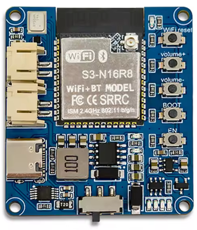
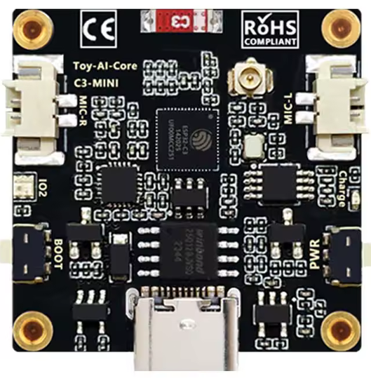
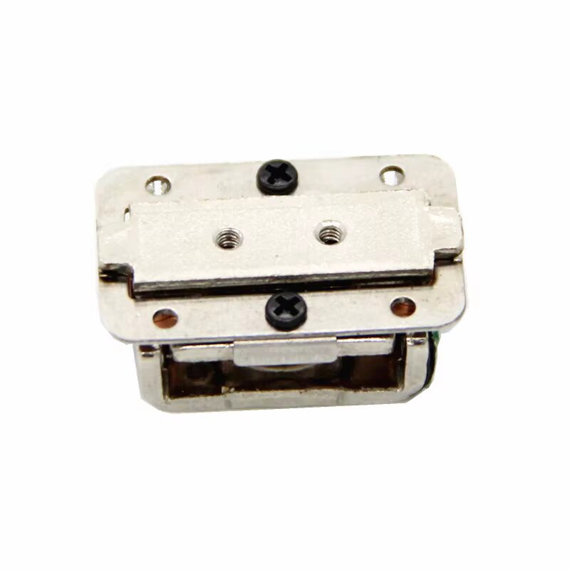
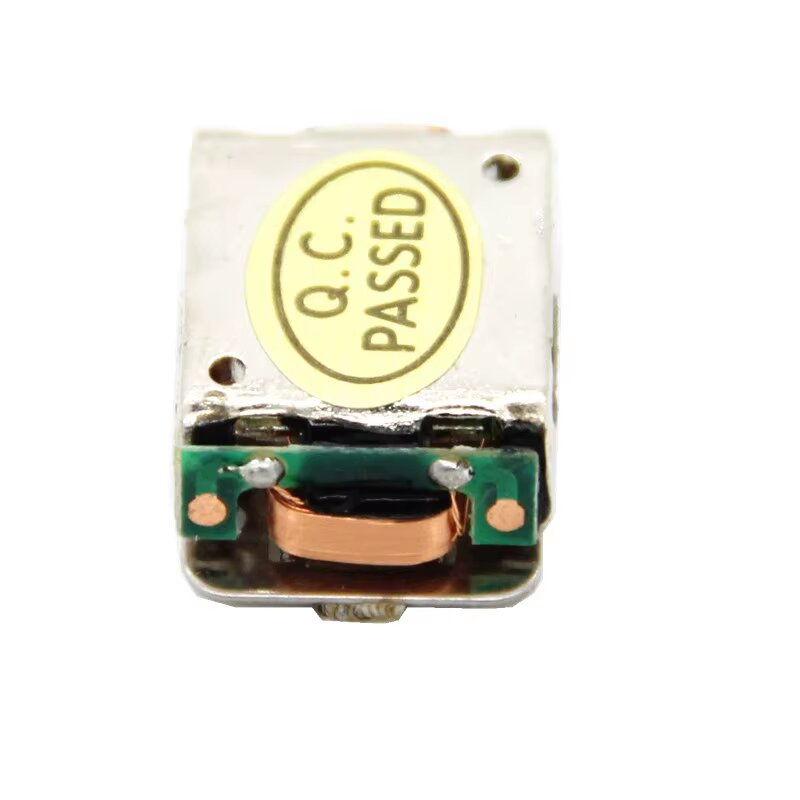

# Canfunk

Canfunk ist ein verschluesseltes Walkie-Talkie aus Konservendosen. Zwei (oder mehr) Dosen sprechen direkt per ESP-NOW miteinander, ganz ohne Router. Ein Smartphone-Hotspot wird nur beim Start fuer Firmware-Updates (OTA) gebraucht.

Die Firmware laeuft auf zwei Hardware-Varianten, die miteinander kompatibel sind:

| | **Variante A: ESP32-S3-Dose** | **Variante B: Toy-AI-Core-C3-MINI** |
|---|---|---|
| PlatformIO-Environment | `retro-phone` (Standard) | `toy-c3` |
| Board | ESP32-S3 Voice-Chat-Board „Xiaozhi AI“ | SpotPear Toy-AI-Core-C3-MINI |
| Mikrofon / Verstaerker / Akku-Laden | auf dem Board | auf dem Board |
| Externe Antenne | meist erst nach Modultausch (siehe Bauanleitung) | IPEX-Anschluss vorhanden |
| Neigungssensor ADXL345 (TILT, Klingeln) | separat eingebaut, Standard | optional, standardmaessig aus |
| Tasten | BOOT, PTT, VOL+, VOL- (auf dem Board) | nur BOOT (Mehrfachklick) |
| Status | im Einsatz getestet | gebaut, noch nicht auf dem Board getestet |

---

## Inhalt

1. [Funktionen](#funktionen)
2. [Software bauen und flashen](#software-bauen-und-flashen)
3. [Warum diese Boards?](#warum-diese-boards)
4. [Bauanleitung Variante A: ESP32-S3-Dose](#bauanleitung-variante-a-esp32-s3-dose)
5. [Bauanleitung Variante B: Toy-AI-Core-C3-MINI](#bauanleitung-variante-b-toy-ai-core-c3-mini)
6. [Konfiguration (platformio.ini)](#konfiguration-platformioini)
7. [Inbetriebnahme: Kalibrieren und Pairing](#inbetriebnahme-kalibrieren-und-pairing)
8. [Bedienung](#bedienung)
9. [OTA-Update ueber Hotspot](#ota-update-ueber-hotspot)
10. [Serielle Konsole](#serielle-konsole)
11. [Technik und Fehlersuche](#technik-und-fehlersuche)

---

## Funktionen

- **Sprechfunk** per ESP-NOW, G.711 u-law, 16 kHz, Mono. Nach dem Pairing mit AES-128 verschluesselt.
- **Drei Sende-Ausloeser:**
  - **Taste (PTT)**: sendet immer, solange sie gehalten wird.
  - **TILT**: Dose zum Mund kippen (35–70 Grad) startet das Senden, ans Ohr halten oder aufrecht stellen beendet es.
  - **VOX**: Sprachaktivierung, sendet sobald man spricht (1 s Nachlauf).
- **Klingeln**: Eine Dose kurbeln (ca. 1 s im Kreis schwenken) laesst alle anderen Dosen klingeln, die **auf dem Kopf** stehen.
- **OTA-Update** per Weboberflaeche ueber einen Smartphone-Hotspot.
- Alle Einstellungen (Lautstaerke, Modus, Empfindlichkeit, Kalibrierung, Schluessel) bleiben im Flash (NVS) gespeichert.

---

## Software bauen und flashen

Benoetigt wird [PlatformIO](https://platformio.org/) (CLI oder VS-Code-Erweiterung). Das Framework (ESP-IDF 5.2.1) laedt PlatformIO beim ersten Build selbst herunter.

```bash
git clone https://github.com/Snake4you/raviolitalk.git
```

```bash
cd raviolitalk
```

```bash
cp platformio_local.ini.example platformio_local.ini
```

In `platformio_local.ini` eigene Zugangsdaten fuer den OTA-Hotspot eintragen (siehe [Eigene Zugangsdaten](#eigene-zugangsdaten-platformio_localini)). Dann bauen und flashen:

```bash
pio run -e retro-phone
```

```bash
pio run -e retro-phone -t upload
```

```bash
pio device monitor -b 115200
```

Fuer Variante B ueberall `-e toy-c3` statt `-e retro-phone` verwenden. Die Firmwaredateien fuer OTA liegen danach unter `.pio/build/<environment>/firmware.bin`.

Mehrere Geraete angeschlossen? Port mit `pio device list` suchen und mit `--upload-port` bzw. `-p` angeben (Linux z. B. `/dev/ttyUSB0`, Windows z. B. `COM8`).

Die Unit-Tests fuer Tilt-, Kurbel- und Lautstaerke-Logik sind eigenstaendige Programme und laufen mit jedem C++-Compiler auf dem PC (kein Fehler = bestanden):

```bash
for t in test/test_*.cpp; do g++ -std=c++17 -Iinclude "$t" -o /tmp/canfunk_test && /tmp/canfunk_test && echo "OK $t"; done
```

---

## Warum diese Boards?

Beide Varianten nutzen fertige „AI-Voice“-Entwicklungsboards. Darauf ist fast alles schon verbaut, was eine Funk-Dose braucht:

- ESP32 (S3 bzw. C3)
- Mikrofon
- Lautsprecher-Verstaerker
- Akku-Ladeschaltung
- Anschluss fuer eine externe Antenne (wichtig, weil die Dose aus Metall ist)

Separat eingebaut werden nur Vibrationslautsprecher, Akku, Antenne und der Neigungssensor ADXL345 (siehe [Lautsprecher und Antenne](#lautsprecher-und-antenne)).

| | **Variante A: ESP32-S3** | **Variante B: ESP32-C3** |
|---|---|---|
| Board |  |  |
| Bezeichnung | ESP32-S3 Voice-Chat-Modul „Xiaozhi AI“ (bread-compact-wifi) | SpotPear Toy-AI-Core-C3-MINI |
| Bezugsquelle (Beispiel) | [eBay 306701296366](https://www.ebay.de/itm/306701296366) | [eBay 920101340708](https://www.ebay.de/itm/920101340708) |
| Modul / Chip | ESP32-S3, 16 MB Flash, 8 MB PSRAM (N16R8) | ESP32-C3 |
| Mikrofon | I2S-MEMS (INMP441-Format) | ueber Audio-Codec ES8311 |
| Verstaerker | I2S-Verstaerker (MAX98357A-Format) | NS4150 |
| Tasten auf dem Board | WiFi reset (PTT), volume+, volume-, BOOT, EN (Reset) | BOOT, PWR |
| Akku-Laden | ja, ueber USB-C | ja, ueber USB-C |
| Externe Antenne | **meist nicht** – siehe unten | ja, IPEX/U.FL |

### Lautsprecher und Antenne

Beide Varianten nutzen dieselben Zusatzteile.

**Vibrationslautsprecher Typ GD01** ([Beispiel](https://de.aliexpress.com/item/1005008884955653.html))

| Montageplatte | Anschluss |
|---|---|
|  |  |

Ein Vibrationslautsprecher (Koerperschallwandler, „Exciter“) hat keine Membran. Er wird fest an eine Flaeche geschraubt oder geklebt und bringt diese zum Schwingen. In der Canfunk-Dose wird so **die Dose selbst zum Lautsprecher**: Es muessen keine Schallloecher gebohrt werden, und der Klang passt zum Dosentelefon.

- Montage: Die Montageplatte (zwei Gewindeloecher) fest mit der Innenseite der Dose verbinden – mit Schrauben durch das Blech oder mit starkem Kleber (Epoxid, Sekundenkleber). Je fester der Kontakt, desto lauter.
- Anschluss: zwei Loetpunkte auf der kleinen Platine, Litze zum Lautsprecher-Ausgang des Boards.
- Die Firmware sperrt die Kurbel-Erkennung waehrend und kurz nach dem Klingelton, weil die vibrierende Dose sonst vom Neigungssensor als Kurbeln erkannt wuerde.

**Kabelantenne 2,4 GHz mit IPEX-Stecker** ([Beispiel](https://de.aliexpress.com/item/1005003941989490.html))

Antenne mit Koaxkabel und IPEX/U.FL-Stecker. Sie wird an den IPEX-Anschluss des ESP-Moduls (S3 nach dem Umloeten, siehe unten) bzw. des C3-Boards gesteckt und **ausserhalb der Dose** oder hinter einem Kunststoffteil befestigt. Beim Kauf darauf achten, dass Steckergroesse (IPEX1/U.FL) und Kabellaenge zum Einbau passen.

---

## Bauanleitung Variante A: ESP32-S3-Dose


### Teileliste (pro Dose)

| Teil | Anzahl | Hinweis |
|---|---:|---|
| ESP32-S3 Voice-Chat-Board „Xiaozhi AI“ ([Beispiel](https://www.ebay.de/itm/306701296366)) | 1 | Mikrofon, Verstaerker, Ladeschaltung und Tasten sind verbaut |
| ESP32-S3-WROOM-1**U**-N16R8 (Modul mit Antennenanschluss) | 1 | nur falls das Board ohne Antennenanschluss kommt (siehe unten) |
| Kabelantenne 2,4 GHz mit IPEX/U.FL ([Beispiel](https://de.aliexpress.com/item/1005003941989490.html)) | 1 | nach aussen fuehren |
| Vibrationslautsprecher GD01 ([Beispiel](https://de.aliexpress.com/item/1005008884955653.html)) | 1 | die Dose wird zum Lautsprecher |
| LiPo-Akku 3,7 V (1S) | 1 | mit passendem Stecker fuer das Board |
| ADXL345 Beschleunigungssensor (I2C-Breakout) | 1 | fuer TILT und Klingeln |
| Konservendose (sauber, entgratet) | 1 | |
| Litze, Heisskleber, Isolierband/Kapton | | |

### Wichtig: externe Antenne / ESP umloeten

Das Bild zeigt ein Board mit Antennenanschluss (kleiner runder IPEX-Stecker auf dem Modul). **Geliefert wird meist die Variante ohne**: Dort steckt ein ESP32-S3-WROOM-1 mit Leiterplattenantenne. In einer Blechdose schirmt das Metall diese Antenne ab, die **Reichweite sinkt extrem**.

Abhilfe:

1. Das ESP32-S3-Modul ausloeten (Heissluft, Flussmittel, Platine vorheizen hilft).
2. Ein **ESP32-S3-WROOM-1U-N16R8** einloeten. Das „U“ bedeutet: IPEX/U.FL-Antennenanschluss statt Leiterplattenantenne. Es muss die **N16**-Variante sein, die Firmware braucht 16 MB Flash.
3. Antenne anschliessen und **ausserhalb** der Dose oder an einer Oeffnung aus Kunststoff montieren.

Vor dem Kauf auf den Fotos pruefen, ob das Modul schon einen IPEX-Anschluss hat – dann entfaellt das Umloeten.

### Was verbaut ist und was angeschlossen wird

Mikrofon, Verstaerker und Tasten sind auf dem Board fest verdrahtet, die Firmware ist darauf eingestellt:

| Funktion | GPIO | auf dem Board |
|---|---:|---|
| BOOT-Taste | 0 | ja |
| PTT (Taste „WiFi reset“) | 1 | ja |
| Mikrofon WS, SCK, SD | 4, 5, 6 | ja |
| Verstaerker BCLK, LRC, DIN | 15, 16, 7 | ja |
| Taste volume- / volume+ | 39 / 40 | ja |
| ADXL345 SDA / SCL | 41 / 42 | **nein, selbst anschliessen** |

Anzuschliessen sind:

- **Vibrationslautsprecher** an den Lautsprecher-Stecker des Boards (Beschriftung auf der Platine beachten).
- **Akku** an den Akku-Stecker. Geladen wird ueber USB-C, der Schiebeschalter schaltet ein und aus.
- **Antenne** an den IPEX-Anschluss des Moduls.
- **ADXL345** an GPIO 41/42:

| ADXL345 | ESP32-S3-Board |
|---|---|
| VCC | 3V3 |
| GND | GND |
| CS | **3V3** (sonst ist der Sensor im SPI-Modus und antwortet nicht) |
| SDO | GND → Adresse `0x53` (an 3V3 → `0x1D`) |
| SDA | GPIO 41 |
| SCL | GPIO 42 |

### Mechanischer Aufbau

1. **Vibrationslautsprecher** innen fest an die Dosenwand oder den Dosenboden schrauben oder kleben. Die Dose selbst ist dann der Lautsprecher, Schallloecher sind nicht noetig.
2. **Board** so einbauen, dass das Mikrofon Richtung Dosenoeffnung zeigt – moeglichst weit weg vom Lautsprecher, damit es im VOX-Modus nicht rueckkoppelt.
3. **ADXL345 fest verkleben**, nicht lose haengen lassen. Die Ausrichtung ist egal (die Firmware kalibriert die Dosenachse), aber der Sensor darf sich danach nicht mehr bewegen. Nach jedem Umbau neu kalibrieren.
4. Die Tasten des Boards (vor allem „WiFi reset“ = PTT, volume+/-, BOOT) ueber Bohrungen erreichbar machen oder mit externen Tastern parallel verlaengern (Taster zwischen GPIO und GND, die Pull-ups sind intern aktiv).
5. USB-C-Buchse und Schiebeschalter zugaenglich lassen (Laden, Flashen, Ein/Aus).
6. Board und Akku innen fixieren. Darauf achten, dass nichts das Blech beruehrt: Dose innen mit Isolierband oder Kapton auskleben.
7. **Antenne nach aussen** fuehren (siehe oben).

### Alternative: Aufbau aus Einzelmodulen

Statt des Boards geht auch ein ESP32-S3-DevKitC (16 MB Flash) mit einzelnen Modulen, verdrahtet nach der Tabelle oben: INMP441 (VDD 3V3, L/R an GND, WS/SCK/SD an 4/5/6), MAX98357A (VIN 5V, BCLK/LRC/DIN an 15/16/7) und Taster gegen GND an GPIO 1, 39 und 40. Andere Pins lassen sich in `platformio.ini` umstellen (siehe [Konfiguration](#konfiguration-platformioini)).

---

## Bauanleitung Variante B: Toy-AI-Core-C3-MINI


Das SpotPear Toy-AI-Core-C3-MINI bringt Audio-Codec (ES8311), Verstaerker (NS4150), Ladeschaltung, BOOT- und PWR-Taste und einen **IPEX-Antennenanschluss** bereits mit. Umloeten ist hier nicht noetig.

### Teileliste (pro Dose)

| Teil | Anzahl | Hinweis |
|---|---:|---|
| SpotPear Toy-AI-Core-C3-MINI ([Beispiel](https://www.ebay.de/itm/920101340708)) | 1 | |
| Kabelantenne 2,4 GHz mit IPEX/U.FL ([Beispiel](https://de.aliexpress.com/item/1005003941989490.html)) | 1 | an den IPEX-Anschluss neben dem ESP32-C3 |
| Vibrationslautsprecher GD01 ([Beispiel](https://de.aliexpress.com/item/1005008884955653.html)) | 1 | die Dose wird zum Lautsprecher |
| LiPo-Akku 3,7 V (1S) | 1 | |
| optional: ADXL345 | 1 | fuer TILT und Klingeln |
| Konservendose | 1 | |

### Belegung (fest auf dem Board)

| Funktion | GPIO |
|---|---:|
| BOOT-Taste (auch an den Steckern BOOT und AWK) | 9 |
| ES8311 MCLK, SCLK, LRCK | 10, 8, 6 |
| ES8311 DSDIN (Lautsprecher), ASDOUT (Mikrofon) | 5, 7 |
| NS4150 Verstaerker-Enable | 11 |
| I2C SDA, SCL (ES8311, Adresse `0x18`) | 3, 4 |
| RGB-LED „IO2“ (WS2812, ungenutzt) | 2 |

Logausgabe, serielle Konsole und Flashen laufen ueber den USB-C-Anschluss (USB Serial/JTAG, kein CH340).

### Optional: ADXL345 nachruesten

Ohne Sensor wird nur per Taste oder VOX gesprochen, und die Dose kann weder kurbeln noch klingeln. Mit Sensor:

| ADXL345 | Toy-AI-Core-C3 |
|---|---|
| VCC | 3V3 |
| GND | GND |
| CS | 3V3 |
| SDO | GND (`0x53`) oder 3V3 (`0x1D`) |
| SDA | Display-Stecker (FPC) Pin 18 |
| SCL | Display-Stecker (FPC) Pin 17 |

Der Sensor teilt sich den I2C-Bus mit dem ES8311 (Adresse `0x18`), die Adressen kollidieren nicht. Danach in `platformio.ini` im Abschnitt `[env:toy-c3]` die Zeile `-DTILT_ENABLE=1` einkommentieren (siehe [Konfiguration](#konfiguration-platformioini)).

### Mechanischer Aufbau

Wie bei Variante A: Vibrationslautsprecher fest an die Dose, Board isoliert befestigen, Mikrofon Richtung Dosenoeffnung, Antenne nach aussen. Die BOOT-Taste von aussen erreichbar machen, z. B. ueber einen externen Taster am BOOT-Stecker. USB-C und PWR-Taste zugaenglich lassen.

---

## Konfiguration (platformio.ini)

Alle Einstellungen stehen **auskommentiert** in [platformio.ini](platformio.ini). So wird eine Option gesetzt:

1. Zeile suchen und das fuehrende `;` entfernen. Die Einrueckung (vier Leerzeichen) muss bleiben.
2. Wert anpassen.
3. Neu bauen und flashen (USB oder OTA).

Nicht gesetzte Optionen behalten den Standardwert aus [src/config.h](src/config.h). Ungueltige Werte (z. B. Lautstaerke 12) brechen den Build mit einer verstaendlichen Fehlermeldung ab.

Die Datei hat drei Abschnitte:

- `[settings]` – gilt fuer **beide** Boards (Funk, OTA, Startwerte, Klingeln)
- `[env:retro-phone]` – nur Variante A (ESP32-S3)
- `[env:toy-c3]` – nur Variante B (C3)

Beispiel: Funkkanal 6 und Startlautstaerke 3 fuer alle Dosen:

```ini
[settings]
build_flags =
    -DESPNOW_CHANNEL=6
    -DDEFAULT_VOLUME=3
```

Text-Werte brauchen die Schreibweise `'-DNAME="Wert"'` mit beiden Anfuehrungszeichen-Arten.

### Eigene Zugangsdaten (platformio_local.ini)

Hotspot-Name und Passwoerter gehoeren nicht ins Git. Die Firmware bringt nur oeffentliche Platzhalter mit (`Canfunk-OTA` / `canfunk-ota` / `canfunk`), und der Build warnt, solange das OTA-Passwort der Platzhalter ist. **Vor dem ersten Flashen eigene Werte setzen:**

```bash
cp platformio_local.ini.example platformio_local.ini
```

Dann in `platformio_local.ini` eintragen:

```ini
[settings]
build_flags =
    '-DOTA_WIFI_SSID="MeinHotspot"'
    '-DOTA_WIFI_PASSWORD="mein-wlan-passwort"'
    '-DOTA_HTTP_PASSWORD="mein-ota-passwort"'
```

`platformio_local.ini` steht in `.gitignore` und wird automatisch mitgelesen. Ihr `[settings]`-Abschnitt **ersetzt** den aus `platformio.ini` komplett; weitere Optionen fuer beide Boards (Kanal, Startwerte, Klingeln) deshalb ebenfalls dort eintragen.

### Alle Optionen

**Funk / OTA** (`[settings]`, auf allen Dosen gleich einstellen!)

| Option | Standard | Bedeutung |
|---|---|---|
| `ESPNOW_CHANNEL` | `13` | WLAN-Kanal 1..13 fuer den Sprechfunk |
| `OTA_WIFI_SSID` | `Canfunk-OTA` (Platzhalter) | Name des Hotspots fuer OTA-Updates |
| `OTA_WIFI_PASSWORD` | `canfunk-ota` (Platzhalter) | WLAN-Passwort des Hotspots, mindestens 8 Zeichen |
| `OTA_HTTP_PASSWORD` | `canfunk` (Platzhalter) | Passwort der OTA-Webseite |

**Startwerte** (`[settings]`, gelten nur fuer Geraete ohne gespeicherte Einstellung, also z. B. nach dem ersten Flashen oder nach Loeschen des Flash)

| Option | Standard | Bedeutung |
|---|---|---|
| `DEFAULT_VOLUME` | `5` | Lautstaerke 1..10 |
| `DEFAULT_VOX_SENS` | `6` | VOX-Empfindlichkeit 1..10 (10 = reagiert auf leise Sprache) |
| `DEFAULT_PTT_MODE_VOX` | `0` | `1` = Start im VOX-Modus, `0` = TILT/Taste |

**Klingeln** (`[settings]`)

| Option | Standard | Bedeutung |
|---|---|---|
| `RING_TONE_LEVEL` | `3.0f` | Lautstaerke des Klingeltons relativ zu den anderen Signaltoenen |
| `RING_SEND_COOLDOWN_MS` | `10000` | Sender: so lange nach dem Kurbeln kein neues Klingeln |
| `RING_RX_COOLDOWN_MS` | `10000` | Empfaenger: so lange nach einem Klingeln kein neues |

**Neigungssensor** (`[env:retro-phone]` bzw. `[env:toy-c3]`)

| Option | Standard | Bedeutung |
|---|---|---|
| `TILT_ENABLE` | S3: `1`, C3: `0` | `1` = ADXL345 vorhanden. `0` = kein Sensor, nur Taste/VOX, kein Klingeln |
| `ADXL_I2C_ADDR` | nicht gesetzt | Feste Sensoradresse (`0x53` oder `0x1D`). Ohne Angabe werden beide probiert |
| `PIN_I2C_SDA`, `PIN_I2C_SCL` | `GPIO_NUM_41`, `GPIO_NUM_42` | I2C-Pins des Sensors (nur S3, beim C3 fest) |

**Audio** (`[env:toy-c3]`)

| Option | Standard | Bedeutung |
|---|---|---|
| `ES8311_MIC_GAIN` | `4` | Mikrofonverstaerkung 0..7 in 6-dB-Schritten (4 = 24 dB) |

**Pins** – jeder Pin aus [src/config.h](src/config.h) laesst sich ebenso ueberschreiben, z. B. fuer einen anders verdrahteten Aufbau:

```ini
[env:retro-phone]
build_flags =
    ${settings.build_flags}
    -DPIN_VOL_UP=GPIO_NUM_38
    -DPIN_VOL_DOWN=GPIO_NUM_37
```

> Startwerte wirken nur, solange nichts gespeichert ist. Um eine bereits benutzte Dose auf die neuen Startwerte zurueckzusetzen, den Flash loeschen (`pio run -e retro-phone -t erase`, danach neu flashen). Dabei gehen Pairing-Schluessel und Kalibrierung verloren. Einzelwerte lassen sich einfacher ueber die Tasten oder die [serielle Konsole](#serielle-konsole) aendern.

---

## Inbetriebnahme: Kalibrieren und Pairing

Nach dem ersten Flashen jede Dose einmal **kalibrieren** (nur mit Sensor) und anschliessend alle Dosen **pairen**.

### 1. Dosenachse kalibrieren (TILT)

Der Sensor ist in jeder Dose anders eingebaut. Die Firmware speichert deshalb die Richtung „Dose steht aufrecht“. Ohne Kalibrierung bleibt TILT im Empfang und die Dose kann nicht klingeln.

1. Dose aufrecht auf den Boden stellen, Oeffnung nach oben.
2. Ausloesen:
   - Variante A: BOOT und PTT gemeinsam **2 Sekunden** halten.
   - Variante B: BOOT **6x klicken**.
   - oder Konsolenbefehl `cal`.
3. Die Dose eine weitere Sekunde ruhig stehen lassen.
4. Ein aufsteigendes Dreifach-Piepen bestaetigt die gespeicherte Achse.

Wiederholen nach jedem Sensorumbau oder wenn der Flash geloescht wurde.

### 2. Pairing

Gepairte Dosen teilen einen AES-Schluessel und hoeren nur noch aufeinander. Ungepairte Dosen senden unverschluesselt an alle.

1. Hotspot aus, beide Dosen einschalten (sie muessen im ESP-NOW-Betrieb sein, siehe [OTA](#ota-update-ueber-hotspot)).
2. Auf beiden Dosen innerhalb von 15 Sekunden Pairing starten:
   - Variante A: VOL+ und VOL- gemeinsam **3 Sekunden** halten (aufsteigende Toene).
   - Variante B: BOOT **5x klicken**.
   - oder Konsolenbefehl `pair`.
3. Ein Bestaetigungston zeigt den Erfolg, der Schluessel ist gespeichert.

**Pairing loeschen:** Variante A VOL+ und VOL- **10 Sekunden** halten (5 schnelle Pieptoene), Variante B nur per Konsolenbefehl `reset`.

---

## Bedienung

### Variante A (ESP32-S3)

| Aktion | Wirkung |
|---|---|
| PTT halten | sprechen (in jedem Modus) |
| Dose zum Mund kippen | sprechen (Modus TILT) |
| einfach sprechen | sprechen (Modus VOX) |
| VOL+ / VOL- | Lautstaerke 1..10, wird gespeichert |
| BOOT halten + VOL+ / VOL- | VOX-Empfindlichkeit aendern (im VOX-Modus) |
| BOOT 5 s halten | TILT/VOX umschalten (aufsteigende Toene = VOX, absteigende = TILT) |
| BOOT + PTT 2 s halten | Dosenachse kalibrieren |
| VOL+ und VOL- 3 s halten | Pairing starten |
| VOL+ und VOL- 10 s halten | Pairing-Schluessel loeschen |
| Dose ca. 1 s kurbeln | andere Dosen klingeln lassen |

### Variante B (Toy-AI-Core-C3, eine Taste)

| BOOT-Taste | Wirkung |
|---|---|
| halten (ab 0,25 s) | sprechen |
| 2x klicken | lauter |
| 3x klicken | leiser |
| 4x klicken | TILT/VOX umschalten |
| 5x klicken | Pairing starten (15 s) |
| 6x klicken | Dosenachse kalibrieren |

### TILT-Zonen

Gemessen wird der Winkel der Dosenachse gegen die kalibrierte Senkrechte. Die Drehung um die eigene Achse ist egal.

| Winkel | Zustand |
|---|---|
| unter 25 Grad | Empfang (Dose steht bzw. ist kaum gekippt) |
| 35–70 Grad | **Senden** (Sprechhaltung) |
| ueber 75 Grad | Empfang (Ohrhaltung) |
| ueber 135 Grad, 0,3 s ruhig | „auf dem Kopf“: Dose klingelt bei Anruf |

Ein Wechsel muss 100 ms stabil sein. Bei starker Bewegung wird der Zustand eingefroren, damit Handbewegungen nicht flattern.

### Klingeln

1. Die angerufene Dose steht **auf dem Kopf** (Oeffnung nach unten) – das ist die „aufgelegte“ Position.
2. An der eigenen Dose ca. 1 Sekunde kurbeln (im Kreis schwenken wie die Kurbel eines alten Telefons). Kurzes Anheben oder Abstellen reicht nicht.
3. Alle gepairten Dosen auf dem Kopf klingeln. Danach ist das Klingeln 10 Sekunden gesperrt (einstellbar).

Klingeln geht nur mit Sensor und Kalibrierung. Per Konsole kann auch mit `ring` geklingelt werden.

### Signaltoene

| Ton | Bedeutung |
|---|---|
| Dreiklang aufsteigend (A-Cis-E) beim Start | bereit, ESP-NOW-Betrieb |
| Doppelton 800/1200 Hz beim Start | mit OTA-Hotspot verbunden, **kein** Sprechfunk |
| Dreifach-Piepen aufsteigend | Kalibrierung gespeichert / Pairing gestartet |
| Doppelton 1500/1800 Hz | Pairing erfolgreich |
| 5 schnelle Pieptoene | Pairing-Schluessel geloescht |
| Ton steigt/faellt mit Stufe | Lautstaerke bzw. Empfindlichkeit geaendert |

---

## OTA-Update ueber Hotspot

Beim Start sucht jede Dose **5 Sekunden** nach dem Hotspot `OTA_WIFI_SSID`:

| Zustand beim Start | Ergebnis |
|---|---|
| Hotspot gefunden | Dose verbindet sich und startet die OTA-Webseite. Sprechfunk geht dabei **nicht**, weil der Hotspot auf einem anderen Kanal laeuft. |
| Hotspot nicht da | Dose wechselt auf ESP-NOW (Kanal `ESPNOW_CHANNEL`): normaler Sprechbetrieb. |

Ablauf:

1. Firmware bauen (`pio run -e retro-phone` bzw. `-e toy-c3`).
2. Smartphone-Hotspot mit SSID `OTA_WIFI_SSID` und Passwort `OTA_WIFI_PASSWORD` einschalten (die Werte aus `platformio_local.ini`), am besten auf 2,4 GHz.
3. Dose neu starten und auf den Doppelton warten.
4. Im Browser `http://dose-<mac>.local` oeffnen, `<mac>` ist die WLAN-MAC in Kleinbuchstaben ohne Doppelpunkte (z. B. `dose-a1b2c3d4e5f6.local`). Sie steht im seriellen Log beim Start. Geht mDNS nicht, die IP in der Hotspot-Geraeteliste nachsehen.
5. Anmelden: Benutzername beliebig, Passwort `OTA_HTTP_PASSWORD`.
6. `.pio/build/<environment>/firmware.bin` hochladen. Die Dose startet danach neu.
7. **Hotspot ausschalten** und alle Dosen neu starten, bevor der Sprechfunk getestet wird.

Fuer Servicezwecke kann die Lautstaerke authentifiziert ueber `POST /volume` mit einem Wert `1` bis `10` gesetzt werden.

Tipp: Die MAC jeder Dose einmal notieren (z. B. Aufkleber auf der Dose), dann ist der mDNS-Name immer bekannt.

---

## Serielle Konsole

Ueber `pio device monitor -b 115200` (Variante A: CH340-USB-UART, Variante B: USB-C direkt). `help` zeigt alle Befehle.

| Befehl | Wirkung |
|---|---|
| `status` | Board, Modus, Lautstaerke, Empfindlichkeit, Dosenachse, Neigung, Lage, Pairing |
| `cal` | Dosenachse kalibrieren (Dose aufrecht hinstellen) |
| `mode tilt` / `mode vox` | Modus setzen |
| `sens <1-10>` | Empfindlichkeit des aktuellen Modus setzen |
| `vol <1-10>` | Lautstaerke setzen, z. B. `vol 3` |
| `pair` | Pairing starten (15 s) |
| `reset` | Pairing-Schluessel loeschen |
| `ring` | andere Dosen klingeln lassen |
| `reboot` | neu starten |

---

## Technik und Fehlersuche

### Architektur

- ESP-IDF 5.2.1 ueber PlatformIO (`espressif32@6.7.0`), 16 MB Flash, eigene Partitionstabelle mit zwei OTA-Slots
- ESP-NOW mit AES-128 und gespeichertem 16-Byte-LMK
- G.711 u-law, 16 kHz, Mono, 240 Samples (15 ms) pro Paket, 30 ms Jitterpuffer
- [src/main.cpp](src/main.cpp): Funk, OTA, Pairing, TILT, Klingeln, Tasten, Konsole
- [src/audio.cpp](src/audio.cpp): I2S-Mikrofon und -Lautsprecher bzw. ES8311-Codec
- [src/config.h](src/config.h): Pins und Standardwerte beider Boards
- [include/](include/): Tilt-Trigger, Kurbel-/Kopflage-Erkennung, Lautstaerkebefehl (hardwareunabhaengig, mit Tests in [test/](test/))

### Haeufige Probleme

| Problem | Ursache / Loesung |
|---|---|
| Dosen hoeren sich nicht | Hotspot noch an (Doppelton beim Start)? Gleicher `ESPNOW_CHANNEL` auf allen Dosen? Eine Dose gepairt, die andere nicht? Beide neu pairen oder beide `reset`. |
| Sehr geringe Reichweite | ESP mit Leiterplattenantenne in der Blechdose. Modul mit IPEX-Anschluss und externe Antenne nach aussen verwenden (siehe Bauanleitung Variante A). |
| Wiedergabe leise oder scheppernd | Vibrationslautsprecher hat keinen festen Kontakt zum Blech: fester verschrauben bzw. vollflaechig kleben. Lose Teile in der Dose fixieren. |
| TILT reagiert nicht | Nicht kalibriert (`status` zeigt die Dosenachse). Sensor nicht gefunden: CS an 3V3? SDA/SCL vertauscht? Im Log steht, an welcher Adresse gesucht wurde. |
| Dose klingelt nicht | Steht sie wirklich auf dem Kopf (`status` → „Lage“)? Cooldown von 10 s abgelaufen? Ohne Sensor ist Klingeln nicht moeglich. |
| Rauschen, Knattern, „Donnern“ beim Empfaenger | `MIC_BIT_SHIFT` wurde geaendert. Er muss `16` sein (siehe unten). |
| VOX sendet staendig / nie | Empfindlichkeit mit BOOT + VOL+/VOL- oder `sens` anpassen. Mikrofon weiter weg vom Vibrationslautsprecher. |
| OTA-Seite nicht erreichbar | mDNS wird von manchen Hotspots nicht weitergereicht: IP in der Hotspot-Liste nachsehen. |

### Mikrofonformat INMP441

Das INMP441 liefert signed 24-Bit-Audio, linksbuendig in einem 32-Bit-I2S-Wort. Fuer 16-Bit-PCM nutzt die Firmware die oberen 16 Bits: `MIC_BIT_SHIFT = 16` in [src/config.h](src/config.h).

Ein Shift von `14` verstaerkt das Mikrofon um Faktor vier. Bei Sprache laeuft der Wert beim Cast nach `int16_t` ueber; beim Empfaenger klingt das wie lautes Rauschen oder Knattern. Diesen Wert nur nach einer erneuten, gemessenen I2S-Formatpruefung aendern.

---

## Lizenz

Apache License 2.0, siehe [LICENSE](LICENSE).
